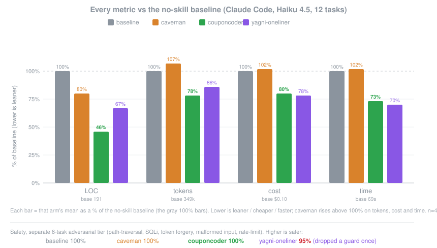
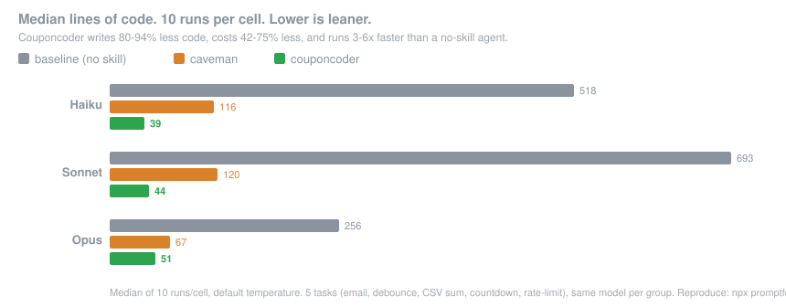

<p align="center">
  <picture>
    <source media="(prefers-color-scheme: dark)" srcset="assets/logo-dark.png">
    
  </picture>
</p>

<h1 align="center">Couponcoder</h1>


## Before / after

You ask for a date picker. Your agent installs flatpickr, writes a wrapper component, adds a stylesheet, and starts a discussion about timezones.

With couponcoder:

```html
<!-- couponcoder: browser has one -->
<input type="date">
```

More survivors in [examples/](examples/).

## Numbers

The honest measurement is a real agent doing real work: a headless Claude Code session editing [tiangolo's full-stack-fastapi-template](https://github.com/fastapi/full-stack-fastapi-template) (a real FastAPI + React repo), scored on the `git diff` it leaves behind. Twelve feature tickets, the same agent with and without the skill, n=4, Haiku 4.5.

<p align="center">
  
</p>

| vs no-skill baseline | LOC | tokens | cost | time | safe |
|---|--:|--:|--:|--:|--:|
| **couponcoder** | **-54%** | **-22%** | **-20%** | **-27%** | **100%** |
| caveman (terse-prose control) | -20% | +7% | +3% | +2% | 100% |
| "YAGNI + one-liners" prompt | -33% | -14% | -21% | -30% | 95% |

couponcoder is the only arm that cuts every metric, and the only one that stays fully safe while doing it. The cut is biggest where there is a real over-build trap (date picker 404 to 23 lines, color picker 287 to 23, because it reaches for a native `<input>` instead of a component) and near zero on code that is already minimal. Full method, per-task tables, and limitations: [benchmarks/results/2026-06-18-agentic.md](benchmarks/results/2026-06-18-agentic.md).

<details>
<summary><strong>Older single-shot numbers (isolated generation)</strong></summary>

Five everyday tasks, three models, three arms (no skill, [caveman](https://github.com/JuliusBrussee/caveman), couponcoder), ten runs, median reported. One prompt, one completion, counting lines of the answer:

<p align="center">
  
</p>

This showed **80-94% less code**. [#126](https://github.com/nsicilia/couponcoder/issues/126) fairly pointed out that the bare-model baseline pads its answer with prose and options, so that gap is partly a conversational-baseline artifact. The agentic numbers above are the corrected, defensible version. Reproduce the single-shot run with `npx promptfoo eval -c benchmarks/promptfooconfig.yaml`.

</details>

**The rule was never "fewest tokens."** It is: write only what the task needs, and never cut validation, error handling, security, or accessibility. The code ends up small because it is necessary, not golfed. Lower cost and latency are a side effect on the models that follow the ladder; a terse reasoning model that spends thinking tokens deliberating the rungs can go the other way (on GPT-5.5 it does).

## How it works

Before writing code, the agent stops at the first rung that holds:

```
1. Does this need to exist?   → no: skip it (YAGNI)
2. Already in this codebase?  → reuse it, don't rewrite
3. Stdlib does it?            → use it
4. Native platform feature?   → use it
5. Installed dependency?      → use it
6. One line?                  → one line
7. Only then: the minimum that works
```

The ladder runs *after* it understands the problem, not instead of it: it reads the code the change touches and traces the real flow before picking a rung. Lazy about the solution, never about reading.

Lazy, not negligent: trust-boundary validation, data-loss handling, security, and accessibility are never on the chopping block.

## Install

The most effort couponcoder will ever ask of you:

The Claude Code and Codex plugins run two tiny Node.js lifecycle hooks, so `node` needs to be on your PATH (note for Nix/nvm users: it must be on the non-interactive shell's PATH). If it isn't, the skills still work, the always-on activation just stays quiet instead of erroring on every prompt.

### Claude Code

```
/plugin marketplace add nsicilia/couponcoder
```
```
/plugin install couponcoder@couponcoder
```
(You have to send two separate prompts for the install to work) 

Same steps in the Claude Code Desktop app's Code tab: type the two `/plugin` commands above into the prompt box, or click the **+** button next to it, choose **Plugins** → **Add plugin** to browse your configured marketplaces, and manage marketplaces from **Customize** in the sidebar.

### VS Code

**With the Claude Code extension** — full plugin, mode switches and all. Run the same two commands from the extension's prompt box, one at a time:

```
/plugin marketplace add nsicilia/couponcoder
```
```
/plugin install couponcoder@couponcoder
```

**On older VS Code (1.90+), without the Claude Code extension** — build and sideload the bundled chat participant:

```bash
npm run package --prefix vscode-extension
```
```bash
code --install-extension vscode-extension/couponcoder-4.8.4.vsix
```

Then talk to `@couponcoder` in the Chat view. `/lite`, `/full`, `/ultra` and `/off` switch levels, and the level sticks per workspace. It borrows a model from GitHub Copilot Chat, so that extension has to be installed and signed in. 1.90 is the floor because it is the first release with a stable chat participant API; older versions have no AI extension point at all — use the Copilot instructions file below.

**With the Codex extension** — nothing to install. It reads [`AGENTS.md`](AGENTS.md), which this repo ships, so it works from the repo root as-is. Copy `AGENTS.md` into your own project to use it there, or put it at `~/.codex/AGENTS.md` to make it global. Always-on rules, no `/couponcoder` levels.

**With GitHub Copilot Chat** — copy [`.github/copilot-instructions.md`](.github/copilot-instructions.md) into your project. Always-on rules, no `/couponcoder` levels.

### JetBrains IDEs

(IntelliJ, PyCharm, GoLand, WebStorm, and the rest.)

**With the Claude Code plugin** — full plugin, mode switches and all. Run the same two commands from the plugin's prompt box, one at a time:

```
/plugin marketplace add nsicilia/couponcoder
```
```
/plugin install couponcoder@couponcoder
```

**With Junie** — copy [`.junie/guidelines.md`](.junie/guidelines.md) into your project. Junie reads that path on its own, so there is nothing to configure. (Alternatively copy [`AGENTS.md`](AGENTS.md) and point Junie at it under **Settings → Tools → Junie → Project Settings → Guidelines Path** — same rules, one more step.) Always-on rules, no `/couponcoder` levels.

**With GitHub Copilot Chat** — copy [`.github/copilot-instructions.md`](.github/copilot-instructions.md) into your project. Always-on rules, no `/couponcoder` levels.

### Codex

```bash
codex plugin marketplace add nsicilia/couponcoder
codex plugin add couponcoder@couponcoder
```

Run `codex` and open `/hooks`, review and trust its two lifecycle hooks, and start a new thread.

This same install also covers the Codex desktop app: restart the app after installing and it picks up the plugin.

### GitHub Copilot CLI

```bash
copilot plugin marketplace add nsicilia/couponcoder
copilot plugin install couponcoder@couponcoder
```

In an interactive Copilot CLI session, use the slash equivalents:

```
/plugin marketplace add nsicilia/couponcoder
/plugin install couponcoder@couponcoder
```

Copilot CLI namespaces plugin commands by plugin name. For example:

```text
/couponcoder:couponcoder ultra
/couponcoder:couponcoder-review
```

### Pi agent harness

```
pi install git:github.com/nsicilia/couponcoder
```

### OpenCode

Add to `opencode.json`:

```json
{ "plugin": ["@nicksicilianosalazar/couponcoder"] }
```

Run from a checkout instead (the plugin reuses `hooks/` and `skills/`):

```json
{ "plugin": ["./.opencode/plugins/couponcoder.mjs"] }
```

Injects the ruleset every turn at the active level; adds the `/couponcoder` commands (see [Commands](#commands)). OpenCode also auto-loads this repo's `AGENTS.md`, so the rules hold even without the plugin. The plugin adds the `lite/full/ultra/off` levels.

The `./` path resolves against your project's `opencode.json`; to share one checkout across projects, point it at the absolute path of the `.mjs` instead (it finds its `hooks/` and `skills/` relative to its own file).

### Gemini CLI

```bash
gemini extensions install https://github.com/nsicilia/couponcoder
```

Loads the ruleset as always-on context every session and registers the `/couponcoder` commands; the `skills/` ship too, activated when a task needs them.
The Gemini adapter intentionally does not ship a root `hooks/hooks.json`: Gemini auto-loads that path, while Couponcoder's lifecycle hooks use Claude/Codex event names.

### Antigravity CLI

Google is renaming Gemini CLI to Antigravity CLI (the `agy` binary); the same extension installs there:

```bash
agy plugin install https://github.com/nsicilia/couponcoder
```

It reuses this repo's `gemini-extension.json`. One difference: Antigravity converts the `/couponcoder` commands into skills, so you type them into the chat (e.g. `/couponcoder-review` as a message) instead of picking them from a slash menu. Until the migration completes (around June 18, 2026), `gemini extensions install` still works too. To run it as an always-on rule instead, drop the ruleset into `.agents/rules/`.

### CodeWhale

Reads `AGENTS.md` from the project root, zero setup. Copy [`AGENTS.md`](AGENTS.md) to your project, or run `codewhale` from a checkout of this repo. That's it.

### Devin CLI

```bash
devin plugins install nsicilia/couponcoder
```

Installs couponcoder as a Devin plugin; skills are available as `/couponcoder:couponcoder`, `/couponcoder:couponcoder-review`, and so on.

That was it. He'd be proud. He won't say it.

Active every session, with a handful of commands (see [Commands](#commands)). `/couponcoder ultra` exists for when the codebase has wronged you personally. Startup and mode-change text shows the current mode.

Set the level for every new session with the `COUPONCODER_DEFAULT_MODE` env var (`lite`/`full`/`ultra`/`off`), or a `defaultMode` field in `~/.config/couponcoder/config.json` (`%APPDATA%\couponcoder\config.json` on Windows). The default is `full`.

While active, the ruleset is also injected into every subagent spawned via the Agent tool. To scope that to specific agent types (say, keep it off read-only search agents), set the `COUPONCODER_SUBAGENT_MATCHER` env var to a regex tested against the subagent's `agent_type`. It is unanchored and case-insensitive: `explore|general` matches either, `^general$` is exact, and plugin agent types look like `plugin:name`. Unset means inject into every subagent (the default); an invalid regex, or a subagent whose type the platform doesn't report, also falls back to injecting.

Editors and agents not covered above — Cursor, Windsurf, Visual Studio (Copilot Chat), Aider, CodeWhale: copy the matching rules file from this repo ([`.cursor/rules/`](.cursor/rules/), [`.windsurf/rules/`](.windsurf/rules/), [`.github/copilot-instructions.md`](.github/copilot-instructions.md), [`AGENTS.md`](AGENTS.md)). For VS Code and JetBrains, see [VS Code](#vs-code) and [JetBrains IDEs](#jetbrains-ides) above.

GitHub Copilot CLI fallback (instruction-only mode): it reads `AGENTS.md` and `.github/copilot-instructions.md` in a project, or copy the rules into `~/.copilot/copilot-instructions.md` to run couponcoder in every project. This path keeps always-on guidance, but does not add plugin mode switches or hooks.

Jules (Google) reads `AGENTS.md` from the repository root, which this repo ships, so it picks up the ruleset with no setup.

Which files map to which agent: [Agent portability](docs/agent-portability.md).

### Uninstall

| Host | Command |
|------|---------|
| Claude Code | `/plugin remove couponcoder` |
| Codex | `codex plugin remove couponcoder` |
| Devin CLI | `devin plugins remove couponcoder` |
| Pi agent | `pi uninstall couponcoder` |
| Cursor / Windsurf / etc. | Delete the copied rule file |

These remove the plugin's own files. They leave behind a small amount of state couponcoder writes outside the plugin folder: the mode flag, `~/.config/couponcoder/config.json`, and (if you accepted the setup nudge) a `statusLine` entry in `~/.claude/settings.json`. Run `node scripts/uninstall.js` to clean those up too. **Run it before the host remove command above** — the script is itself a plugin file, so removing the plugin first deletes it (or run it from a separate clone of this repo). It only removes the statusLine entry if it points at couponcoder's own script, so a statusline you set up yourself is left untouched.

## Commands

| Command | What it does |
|---------|--------------|
| `/couponcoder [lite \| full \| ultra \| off]` | Set the intensity, or turn it off. No argument reports the current level. |
| `/couponcoder-review` | Review the current diff for over-engineering, hands back a delete-list. |
| `/couponcoder-audit` | Audit the whole repo for over-engineering, not just the diff. |
| `/couponcoder-debt` | Harvest the `couponcoder:` shortcuts you've deferred into a ledger, so "later" doesn't become "never". |
| `/couponcoder-gain` | Show the measured impact scoreboard (less code, less cost, more speed) from the benchmark. |
| `/couponcoder-help` | Quick reference for the commands above. |

Commands need a skill-capable host (Claude Code, Codex, Devin CLI, OpenCode, Gemini, pi). In Codex they're skills, invoke with `@` (`@couponcoder-review`). The instruction-only adapters (Cursor, Windsurf, Copilot, Antigravity) load the always-on ruleset without the commands.

## Development

When changing the compact rule text, keep the agent copies aligned:

```bash
node scripts/check-rule-copies.js
npm test
```

This is an internal fork and does not publish. The npm publish path is removed and `package.json` is marked private; `npm test` fails if either is reintroduced. Distribute through the internal registry instead.

The correctness benchmark spawns Python for email and CSV checks; `python3` is tried before `python`. CSV checks need `pandas` installed locally.

## License

[MIT](LICENSE). The shortest license that works.

## Credits

A fork of [ponytail](https://github.com/DietrichGebert/ponytail) by Dietrich Gebert, used under the MIT license.
